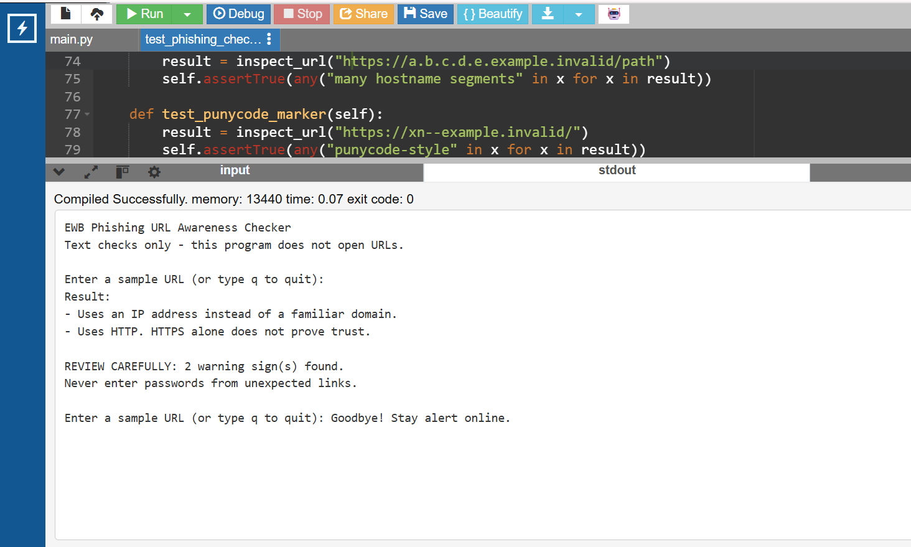
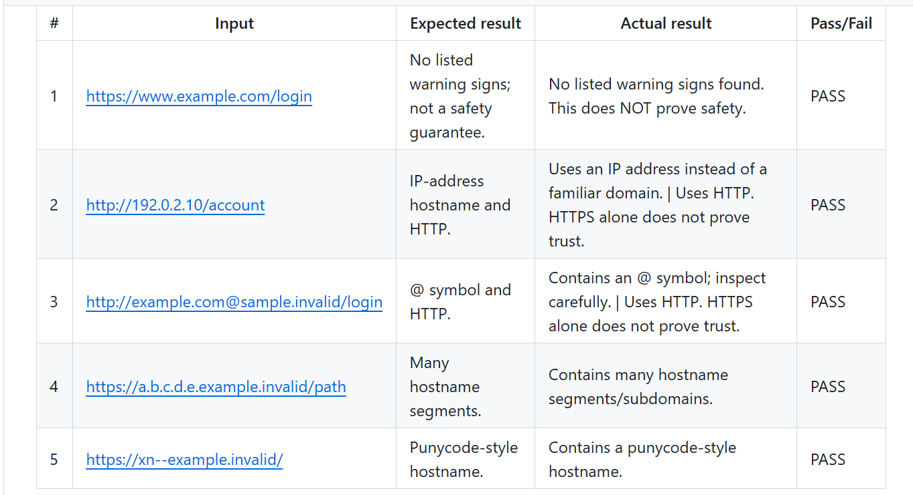

# EWB Phishing URL Awareness Checker

A beginner-friendly cybersecurity mini project written in Python. It inspects the **text** of a URL for selected warning signs that may be associated with phishing. It is designed for defensive awareness and learning.

> **Safety note:** This is a heuristic learning tool, not a security verdict. “No listed warning signs found” does **not** mean a URL is safe.

## Features

- Flags an `@` symbol in the URL text.
- Flags URLs longer than 100 characters.
- Flags hostname text that has the shape of an IPv4 address.
- Flags hostnames with 5 or more dot-separated segments.
- Flags a punycode marker (`xn--`) in the hostname.
- Flags the HTTP scheme.
- Handles empty input and malformed URL text without crashing.
- Lets the user inspect multiple samples in one run and quit with `q`, `quit`, or `exit`.
- Prints a “REVIEW CAREFULLY” summary when warning signs are found.

## Requirements

- Python 3.10 or later
- No third-party packages or API keys

## How to Run

Open a terminal in this project folder.

**Windows**
```bash
python phishing_checker.py
```
If `python` is not recognised, try:
```bash
py phishing_checker.py
```

**macOS / Linux**
```bash
python3 phishing_checker.py
```

Type a sample URL when prompted. Type `q` to quit. Use the safe sample strings in `tests/test_samples.md`; do not open suspicious links.

## Example

Input:
```text
http://192.0.2.10/account
```

Example output:
```text
Result:
- Uses an IP address instead of a familiar domain.
- Uses HTTP. HTTPS alone does not prove trust.

REVIEW CAREFULLY: 2 warning sign(s) found.
Never enter passwords from unexpected links.
```

## Testing

Automated unit tests are included in `tests/test_phishing_checker.py`. Run them from the project root:

```bash
python -m unittest discover -s tests -v
```

On macOS/Linux, use `python3` instead of `python` if needed.

The five required sample cases and their expected/observed results are documented in [`tests/test_samples.md`](tests/test_samples.md). Re-run the program on your own computer and update the Python version, operating system, date, and screenshot evidence before submission.

## Improvements

1. **Repeat-and-quit interaction:** The program can inspect multiple URL strings without restarting. Enter `q`, `quit`, or `exit` to end the session.
2. **Malformed-input handling:** URL parsing errors such as `http://[bad` are handled with a clear message instead of crashing.
3. **Warning summary:** When warning signs are found, the program prints a “REVIEW CAREFULLY” message and the count of findings.

## Screenshots

Save your own genuine screenshots from your computer in the `screenshots/` folder using these exact names:

- `sample_run.png` — terminal showing the command, sample input, and program output.
- `test_results.png` — terminal showing the automated test results or the completed test table.

The README image previews will appear after you add those files:
- 
- 

## Limitations

- The program reads URL text only. It does not open or visit URLs.
- It does not send network requests, scan websites, detect malware, or query reputation services.
- It checks only six visible indicators. It may miss dangerous URLs and may flag harmless ones.
- The IP-address check is a simple pattern check, not a complete validation of every possible address.
- HTTPS alone does not prove that a website is trustworthy.

## Ethical Use

- Use the reserved example strings supplied with this project for testing.
- Do not collect credentials, send phishing messages, or open suspicious links to test them.
- Do not scan or probe websites or networks without written authorisation.
- Never commit passwords, access tokens, or private data to GitHub.

## Author

Durga R  
EWB Courses — Cybersecurity Mini Project  
Batch:1
